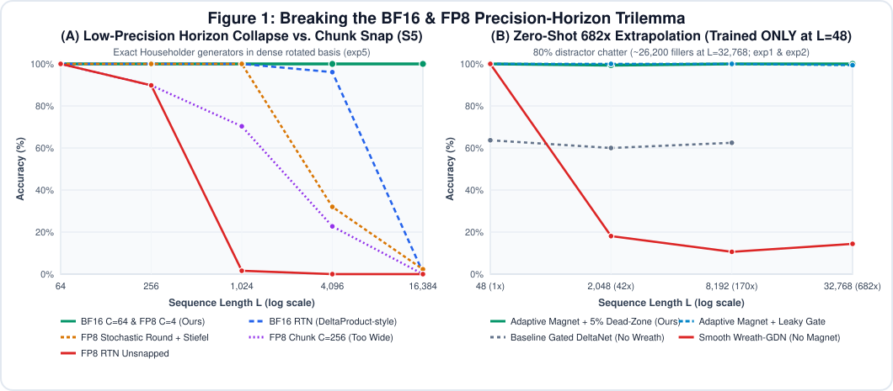
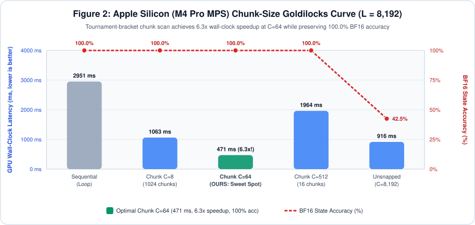
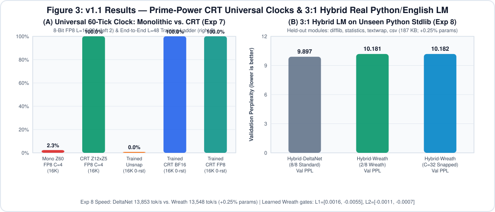

# Dual-Gear Wreath-DeltaNet & Recursive Block Diffusion

**Breaking the Precision–Horizon–Expressivity Trilemma in Sub-Quadratic ($`O(N)`$) Sequence Models**

[](https://doi.org/10.5281/zenodo.24564919)
[](https://doi.org/10.5281/zenodo.24532886)
[](LICENSE)
[](https://www.python.org/)
[](#reproducing-the-benchmarks--figures)

> *Independent open-source research built on a 24 GB Apple Silicon laptop in Finland. All experiments, proofs, and vector figures are reproducible from scratch with PyTorch + NumPy.*

---

## In Plain English (30-Second Summary)

Fast $`O(N)`$ sequence models (like Mamba and Gated DeltaNet) avoid the quadratic memory explosion of standard Transformers, which makes them great for running long-context AI locally. **The catch:** when you run them in fast 16-bit (BF16) or 8-bit (FP8) arithmetic, they hit a wall:

1. **Forgetting vs. Drifting:** If their memory gently decays over time, they forget exact long-range state (like variable swaps or modular counters). If they remove decay so memory never fades, tiny BF16/FP8 rounding errors pile up every token until the state turns into random noise.
2. **Our Fix (Dual-Gear + Chunk-Boundary Snapping):** Instead of forcing one matrix to do everything, we split memory into two cooperating parts:
   - **Worker 1 (The Tracker):** Tracks discrete permutations ($`\{-1, 0, +1\}`$ **Swap-Boxes**) and cyclic counters (**Prime-Power 2D Clock-Dials**, e.g. $`\mathbb{Z}_4 \times \mathbb{Z}_3 \times \mathbb{Z}_5 \cong \mathbb{Z}_{60}`$). Inside each short chunk of $`C`$ tokens ($`C = 64`$ in BF16, $`C = 4`$ in FP8), updates stay 100% linear and GPU-parallel. **Only at chunk boundaries**, we snap the tracker back to its nearest exact grid point—resetting floating-point drift to **strictly zero** forever.
   - **Worker 2 (The Value Memory):** A standard Gated DeltaNet whose keys and queries rotate inside Worker 1's frame, paired with **5% Dead-Zone Gates** so thousands of irrelevant filler tokens cannot slowly leak into memory.
3. **What That Unlocks:** A model trained **only at length $`L = 48`$** stays at **100.0% accuracy at $`L = 32{,}768`$ (682× longer!) in BF16**, hits **100.0% at $`L = 16{,}384`$ in 8-bit FP8** across both $`S_5`$ permutations and universal 60-tick clocks (with zero mid-sequence resets), runs **6.3× faster** on Apple Silicon GPU via chunk-parallel scans, and drops cleanly into a 3:1 Hybrid LM on real Python code with only **+0.001** snap perplexity shift.

---

## Visual Overview (v1.1.0)







---

## Technical Overview: The Precision–Horizon–Expressivity Trilemma

Sub-quadratic sequence models (Mamba-2/3, Gated DeltaNet-1/2, DeltaProduct) face three colliding constraints:

1. **Contractive recurrences ($`|\lambda| < 1`$)** stay numerically bounded in BF16/FP8, but collapse into $`\mathrm{TC}^0`$—failing parity, modular clocks ($`\mathbb{Z}_m`$), and non-abelian $`\mathrm{NC}^1`$ permutations ($`S_5`$).
2. **Isometric recurrences ($`|\lambda| = 1`$)** unlock $`\mathrm{NC}^1`$ expressivity in exact arithmetic, yet suffer catastrophic floating-point drift at finite horizons ($`L^* = \Theta(2^p)`$ under Round-to-Nearest; $`L^* = \Theta(2^{2p}/d)`$ under Stochastic Rounding).
3. **Token-level discrete FSMs (NFSM)** eliminate drift, but break intra-chunk linearity (WY/SSD GPU GEMMs) and continuous associative $`O(d^2)`$ key-value memory.

**Dual-Gear Wreath-DeltaNet** resolves all three simultaneously via Krohn-Rhodes semigroup decomposition:
* **Dual-Gear Worker 1 (Orthogonal Group Frame):** Combines $`\{-1, 0, +1\}`$ signed-permutation **Swap-Boxes** ($`\ell_4`$ Stiefel valley alignment) with **Prime-Power CRT Unit-Circle 2D Clock-Dials** ($`\mathbb{Z}_4 \times \mathbb{Z}_3 \times \mathbb{Z}_5 \cong \mathbb{Z}_{60}`$, angles 90° / 120° / 72°). Evaluated linearly inside chunks of length $`C`$ and snapped *only at chunk boundaries* ($`C = 64`$ for BF16, $`C = 4`$ for FP8 E4M3), yielding provable **$`L^* = \infty`$** drift immunity (Theorem 1).
* **Clean Worker 2 (Wreath-Rotated Multi-Head Gated DeltaNet):** Co-rotates keys and queries in Worker 1's orthogonal prefix frame ($`k_t^{\mathrm{eff}} = U_t^\top k_t`$) with **5% Write & Address Dead-Zones** that eliminate distractor leakage and FP8 cross-slot splash.

---

## Headline Results (v1.0 + v1.1)

| Benchmark | Baseline (BF16 / FP8) | **Dual-Gear Wreath-DeltaNet (Ours)** | Script |
| :--- | :---: | :---: | :--- |
| **Zero-Shot BF16 Extrapolation ($`L = 48 \to 32{,}768`$, 682×)** | 14.4% *(Smooth)* / 62.5% *(GDN)* | **100.0%** *(across ~26,200 distractors)* | [exp1_adaptive_locking.py](exp1_adaptive_locking.py), [exp2_deadzone_gate.py](exp2_deadzone_gate.py) |
| **8-Bit FP8 $`S_5`$ Word Problem ($`L = 16{,}384`$)** | 0.0% *(RTN)* / 2.3% *(Stoch. Round)* | **100.0%** *($`C = 4`$ Chunk-Snapped)* | [exp5_fp8_and_clock_gears.py](exp5_fp8_and_clock_gears.py) |
| **8-Bit FP8 12-Hour Clock & Write-Once ($`L = 8{,}192\text{--}16{,}384`$)** | 40.6% *(Clock)* / 12.5% *(Write-Once)* | **100.0% / 100.0%** | [exp5_fp8_and_clock_gears.py](exp5_fp8_and_clock_gears.py), [exp6_trm_ncm_wreath.py](exp6_trm_ncm_wreath.py) |
| **State-Conditioned Swaps ($`L = 8{,}192`$, Alternating Layers)** | 61.7% *(Standard / Naive 2-Layer)* | **100.0%** *(20% faster training)* | [exp3_conditional_two_layer.py](exp3_conditional_two_layer.py) |
| **2-Hop Chained Conditionals (1 Shared Block, 3 Passes)** | 46.9% *(Pass 1)* | **93.8%** *(Pass 3, +46.9 pts)* | [exp4b_refinement_v2.py](exp4b_refinement_v2.py) |
| **Apple Silicon (MPS) Chunk-Scan Speedup ($`L = 8{,}192`$)** | 2,951 ms *(Sequential)* | **471 ms** *(6.3× faster, 100% acc)* | [bench_gpu_chunks.py](bench_gpu_chunks.py) |
| **v1.1 Universal 60-Tick CRT Clock ($`\mathbb{Z}_4 \times \mathbb{Z}_3 \times \mathbb{Z}_5`$, $`L = 16{,}384`$, 0-reset)** | 0.0% BF16 / 7.8% FP8 *(Unsnapped)* | **100.0% BF16 ($`C = 64`$) & 100.0% FP8 ($`C = 4`$)** *(all 8 moduli $`\bmod\ 2\text{--}60`$)* | [exp7_universal_60tick_dial.py](exp7_universal_60tick_dial.py) |
| **v1.1 3:1 Hybrid Real Python Stdlib LM (4 Unseen Modules)** | Val PPL = 9.897 *(13,853 tok/s)* | **Val PPL = 10.181 → 10.182 snapped** *(+0.001 snap delta, +0.25% params, 13,548 tok/s)* | [exp8_hybrid_text_perplexity.py](exp8_hybrid_text_perplexity.py) |

> **Honest Scope Note (`exp8`):** On a short 320-step byte-level language-modeling run (~1.86M params on unseen Python stdlib files `difflib`, `statistics`, `textwrap`, `csv`), zero-initialized Wreath heads confirm safe fallback (+0.001 perplexity shift under $`C = 32`$ snapping), while natural prose gradients keep the learned gates near Identity (`|wreath_gate| < 0.006`). Awakening full discrete group circuits inside general-purpose text LMs remains an open scaling direction—see [PAPER_DRAFT.md §4.7 & §5](PAPER_DRAFT.md#47-31-hybrid-real-python--english-perplexity-check-exp8_hybrid_text_perplexitypy-v11).

---

## Where to Read Next

* **[PAPER_DRAFT.md](PAPER_DRAFT.md)** — Full manuscript with Theorems 1–3, proof sketches, architecture diagram, embedded figures, complete tables, and limitations.
* **[LAB_NOTEBOOK.md](LAB_NOTEBOOK.md)** — Chronological research diary logging hypotheses *before* running each experiment, surprises (like the 30° clock vs. 90° snap crash and CRT subgroup traps), and ablation tables.
* **[results/](results/)** — Raw JSON outputs from the v1.1 benchmarks (`exp7_universal_60tick.json`, `exp8_hybrid_text_perplexity.json`).

---

## Reproducing the Benchmarks & Figures

```bash
pip install torch numpy

# 1. Adaptive performance-gated valley locking & 682x BF16 extrapolation
python3 exp1_adaptive_locking.py
python3 exp2_deadzone_gate.py

# 2. Alternating layer specialization & weight-shared 3-pass TRM refinement
python3 exp3_conditional_two_layer.py
python3 exp4b_refinement_v2.py

# 3. 8-bit FP8 chunk scaling law (C=4 vs C=64) & 2D 30-degree Clock-Dials
python3 exp5_fp8_and_clock_gears.py
python3 exp6_trm_ncm_wreath.py

# 4. Apple Silicon MPS / GPU chunk-parallel tournament scan benchmark
python3 bench_gpu_chunks.py

# 5. Stage 2: Unsupervised SuperBPE + CoBPE Block-Diffusion Language Model
python3 stage2/run_block_diffusion_stage2.py

# 6. v1.1: Universal 60-Tick Prime-Power CRT Dials (Z_4 x Z_3 x Z_5) & 3:1 Hybrid Real Python LM
python3 exp7_universal_60tick_dial.py
python3 exp8_hybrid_text_perplexity.py

# 7. Regenerate all 3 vector SVG figures from live JSON results (zero extra dependencies!)
python3 generate_figures.py
```

---

## Citation

If you build upon Dual-Gear Wreath-DeltaNet or the Three-Regime Horizon Scaling Law, please cite the archived Zenodo v1.1.0 record ([10.5281/zenodo.24564919](https://doi.org/10.5281/zenodo.24564919); all-versions Concept DOI: [10.5281/zenodo.24532886](https://doi.org/10.5281/zenodo.24532886)) and **[PAPER_DRAFT.md](PAPER_DRAFT.md)**:

```bibtex
@software{markus_2026_wreath_deltanet,
  author       = {Markus (Manageriii)},
  title        = {Dual-Gear Wreath-DeltaNet \& Recursive Block Diffusion: Breaking the Precision-Horizon-Expressivity Trilemma in Sub-Quadratic Sequence Models},
  month        = nov,
  year         = 2026,
  publisher    = {Zenodo},
  version      = {v1.1.0},
  doi          = {10.5281/zenodo.24564919},
  url          = {https://doi.org/10.5281/zenodo.24564919}
}
```
